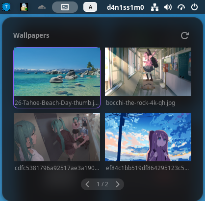

# Wallpaper Carousel

Галерея обоев в верхней панели GNOME Shell: откройте меню, выберите изображение и установите его одним нажатием.



## Возможности

- Компактная сетка из двух колонок: до четырёх обоев на странице. При большем количестве изображений появляется навигация.
- Превью с одинаковыми пропорциями **16:9**; исходные файлы не обрезаются и не изменяются.
- Подсветка выбранных обоев и кнопка обновления списка в заголовке меню.
- Установка выбранного изображения для светлого и тёмного режима GNOME.
- Поддержка файлов `.jpg`, `.jpeg`, `.png` и `.webp`.

## Требования

GNOME Shell **50 или 51**. Изображения считываются из папки `Wallpapers` внутри системной папки «Изображения» (`xdg-user-dir PICTURES`). Другие версии GNOME Shell в `metadata.json` не заявлены.

## Установка

Из каталога проекта скопируйте файлы расширения в пользовательский каталог GNOME Shell:

```bash
extension_dir="$HOME/.local/share/gnome-shell/extensions/wallpaper-carousel@d4n1ss1m0"
mkdir -p "$extension_dir"
cp extension.js stylesheet.css metadata.json "$extension_dir/"
gnome-extensions enable wallpaper-carousel@d4n1ss1m0
```

Если GNOME не обнаружил новое расширение сразу, выйдите из сеанса и войдите снова, затем включите его. На Wayland перезапуск Shell через `Alt+F2` → `r` не применяется.

## Использование

Создайте папку для обоев и поместите туда изображения:

```bash
mkdir -p "$(xdg-user-dir PICTURES)/Wallpapers"
```

Нажмите на значок обоев в верхней панели. Выберите карточку для установки изображения; кнопка обновления перечитает папку. Расширение устанавливает исходный файл, а не обрезанное превью.

## Разработка

`extension.js` содержит меню, загрузку превью и смену фона; `stylesheet.css` отвечает за оформление. Перед изменением поведения прочитайте [AGENTS.md](AGENTS.md). Проверить синтаксис можно командой `node --check extension.js`.

Проект [gnome-setup](https://github.com/d4n1ss1m0/gnome-setup) использует этот каталог как локальный источник расширения при восстановлении настроек GNOME.
